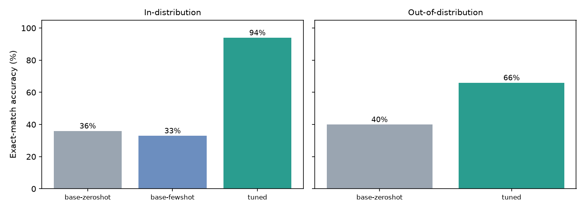
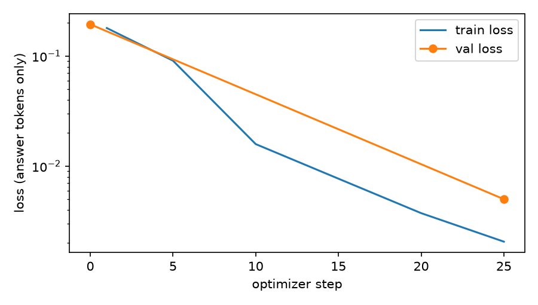

# LoRA Fine-Tuning for Invoice Field Extraction

Fine-tuning a small open LLM (**Qwen2.5-0.5B-Instruct**) with **LoRA** to turn messy invoice text (emails, OCR output, tables, chat messages) into a strict JSON record, and **measuring honestly** whether the tuning helps, including on invoice layouts the model never saw.

The whole thing trains and evaluates on a laptop CPU (no GPU). A Colab notebook runs the same code with a larger model.



## Headline results

Exact match means **every field** of the invoice is correct. 100 invoices per test set, greedy decoding.

| Model | Seen layouts (new invoices) | Unseen layouts |
|---|---|---|
| Base, zero-shot | 36% | 40% |
| Base, 2-shot prompting | 33% | not run (see limitations) |
| **Base + LoRA (this project)** | **94%** | **66%** |

Per-field accuracy, valid-JSON rates and per-layout numbers are in [`results/RESULTS.md`](results/RESULTS.md). Raw predictions for every run are in `results/*.predictions.jsonl`, so every number can be audited.

**Takeaways**
1. **Tuning beats prompting for this task.** Two worked examples in the prompt did not help (33% vs 36%), partly because the base model kept adding keys the schema doesn't allow (`payment_due`, `tax_amount`), which dropped strict-schema validity to 23%. The tuned model was 100% schema-valid.
2. **It generalizes only partly.** On layouts never seen in training, whole-invoice accuracy falls from 94% to 66%, still 26 points above the base model. The gap is the main finding, not a footnote.
3. **Money extraction transfers well.** The `total` field was 99% correct on unseen layouts; the failures are elsewhere (below).

## What the model gets wrong on unseen layouts

Error analysis of the tuned model on the 100 unseen-layout invoices (field errors, one invoice can have several):

| Field | Errors | Cause observed in the predictions |
|---|---|---|
| `invoice_date` | 24 | Appears to mix up the issue date with the distractor "shipped" date, and expands 2-digit years (`25`) to the wrong year (`2023`); training only contained 4-digit years (causes inferred from sampled predictions, not tested by ablation) |
| `invoice_number` | 14 | Often picks the PO number when a `REF` label sits next to an `ORDER REF` line |
| `due_date` | 8 | Date confusion, same family as above |
| `total` | 1 | |
| `vendor`, `currency`, `po_number` | 0 | |

By layout: the "statement" layout scored 24/50 exact match, the informal "chat message" layout 42/50. These are specific, fixable data-coverage problems, not a general failure.

## How it works

```
src/generate_data.py   synthetic invoices: 5 training layouts + 2 held-out layouts, fixed seed
src/train.py           plain PyTorch + PEFT LoRA loop (loss only on the answer tokens)
src/evaluate.py        zero-shot / few-shot / tuned evaluation, batched generation
src/metrics.py         JSON validity, strict schema, per-field accuracy, exact match
src/report.py          tables and charts from results/*.metrics.json
scripts/run_experiment.sh   end-to-end reproduction
notebooks/train_on_colab.ipynb   same pipeline with a 1.5B model on a free T4 GPU
```

**Task.** Input: free-form invoice text. Output: JSON with 7 fields (`invoice_number`, `vendor`, `invoice_date`, `due_date`, `currency`, `total`, `po_number`). Dates are normalized to ISO, `total` is the final amount due including tax, `po_number` may be `null`. The text includes distractors (ship dates, bill-to company, phone numbers, subtotals and tax lines, OCR-style typos in labels).

**Data.** Fully synthetic and seeded, so it is reproducible and contains no real company, personal or payment data. Three splits test different things:
- `train` / `val`: five layouts (key-value, email, OCR-style, table, remittance prose)
- `test_id`: new invoices rendered with those same five layouts
- `test_ood`: two layouts **never seen in training** (statement, chat message) with a different date format and number styles

The generator asserts that no text appears in more than one split, and CI checks the committed data matches the generator output.

**Training.**
- LoRA rank 16, alpha 32, dropout 0.05 on all attention and MLP projections (`q,k,v,o,gate,up,down`): **8.8M trainable parameters, 1.75% of the model**.
- Loss is computed **only on the assistant's JSON**, with the prompt tokens masked, so the model isn't trained to reproduce the instructions.
- AdamW, lr 2e-4 with 5% warmup and cosine decay, effective batch size 8, gradient clipping at 1.0.
- 200 training examples, 1 epoch (25 optimizer steps), about 32 minutes on a 4-core laptop CPU. Validation loss went from 0.194 to 0.005.
- The saved adapter is about 35 MB; the base model is untouched.



## Run it

```bash
python -m venv .venv && source .venv/bin/activate        # Windows: .venv\Scripts\activate
pip install -r requirements.txt -r requirements-dev.txt
pytest -q                                                 # unit tests, no model download
bash scripts/run_experiment.sh                            # about 2 h on CPU; much faster on a GPU
python -m src.predict --adapter outputs/qwen0.5b-lora --text "Invoice 4471 from Acme Ltd, due 30 days..."
```

Environment note: on Windows with an older VC++ runtime, current PyTorch wheels may fail to load. Pinning `torch==2.6.0` and `transformers<5` fixed it here.

For a bigger run on a GPU, open `notebooks/train_on_colab.ipynb` in Colab.

## Limitations (read before quoting the numbers)

- **Synthetic data.** The invoices are generated from templates. This measures how well the model learns the task and generalizes across layouts I defined, not how it performs on real-world invoices. Real documents would be messier.
- **Small test sets, one run.** 100 invoices per set and a single training seed. At 66% a 95% confidence interval is roughly ±9 points, so small differences between rows are not meaningful. The big gaps (94% vs 36%) are.
- **Unseen layouts are only two.** The out-of-distribution result reflects two specific layouts, so it is a signal, not a complete generalization measure.
- **One missing cell.** The 2-shot baseline on unseen layouts was not run; I stopped the job to wrap up. The 2-shot baseline on seen layouts was.
- **Small training budget.** 200 examples, 1 epoch, no hyperparameter search. Better results are plausible with more layout diversity, and I did not test that.
- **Validation loss is not generalization.** The validation set uses the same layouts as training, which is why the unseen-layout split exists.

## What I would do next

1. Add layout and date-format diversity to the training data (including 2-digit years and distractor dates), then re-measure on fresh unseen layouts to see if the gap closes.
2. Train on a larger model on a GPU (the Colab notebook) and compare against the 0.5B result.
3. Constrain decoding to the JSON schema, which would remove any chance of invalid output.
4. Evaluate on real, de-identified documents, with a human-labelled test set.
5. Add a confidence signal and route low-confidence extractions to human review.
